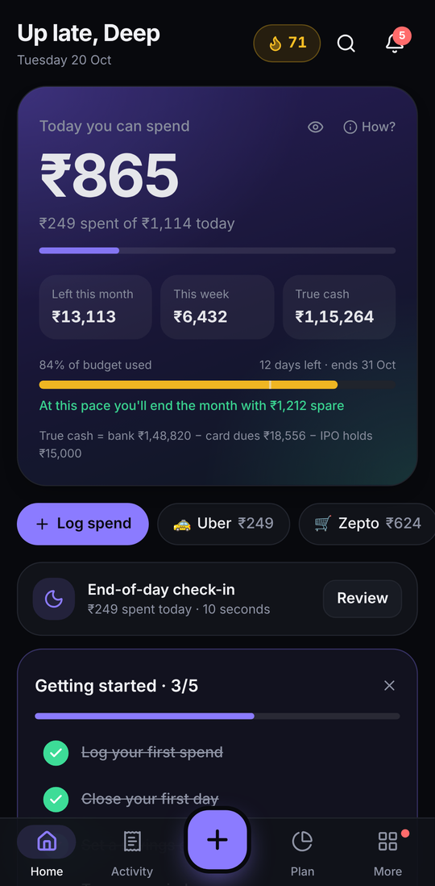
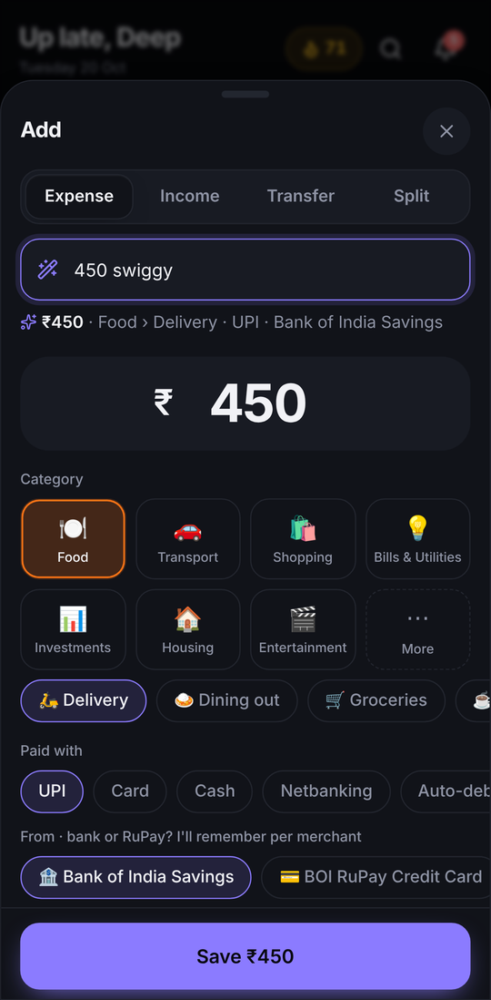
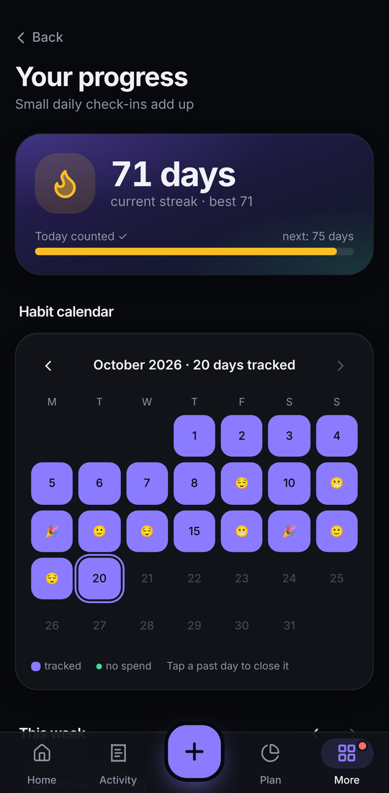
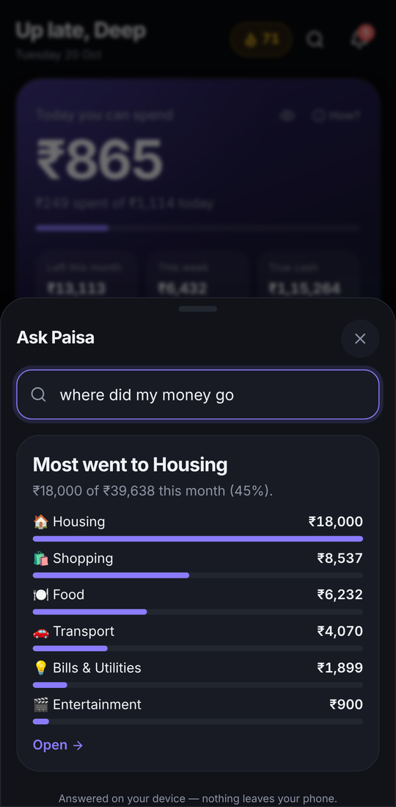

# Paisa OS

A single-user, mobile-first personal finance PWA for India that answers one question at any moment: **how much can I still safely spend this month?** The answer accounts for UPI spends, credit-card swipes, rent and bills, IPO money blocked in bids, money friends owe you, and savings goals.

Built from the product spec in [`docs/PRD.md`](docs/PRD.md).

<p>
  
  
  
  
</p>

## The daily loop

Paisa OS is built to be opened every day, briefly:

1. **Morning** — a notification tells you what you can spend today.
2. **During the day** — log a spend in two taps: tap a "log again" chip, type `120 chai upi`, or paste a bank SMS. Every save can be undone.
3. **Evening** — close the day in ten seconds: check what you logged, pick a mood, keep your streak. A 9 PM nudge opens this directly.
4. **Sunday** — the weekly review compares this week with the same days of last week, shows where the money went, and gives one tip.

Streaks, no-spend days, a habit calendar and badges live on the **Progress** page (`/review`). A first-week checklist on Home walks new users through logging, closing a day, a goal, reminders and installing the app.

## Try it in 30 seconds

```bash
npm install
npm run dev
```

Open http://localhost:3000 and tap **"Just exploring? Load demo data instead"**, or go through the 3-minute setup. With no configuration the app runs in **local-only mode**: data stays in the browser's IndexedDB and there's no sign-in.

## How the numbers work

The app budgets on **spend date, not settlement date**. A ₹1,200 card swipe reduces this month's budget the moment it happens, so paying the card bill later is a *transfer* and never counts as a second expense.

```
month  = income − fixed commitments − investments − goal reserve − buffer − spent (UPI + card + cash) − IPO holds
today  = (month − upcoming variable bills) ÷ days left in the cycle
```

The home screen shows three numbers: **Today you can spend** (unused allowance rolls into later days), **Left this month**, and **True cash**, which is bank balance minus all card dues and IPO holds. Money friends owe you is always left out until it's actually received. Tap **How?** for a line-by-line breakdown. Below the numbers, a pace line projects the month end from your routine run-rate ("you'll end with ₹1,212 spare").

Until this cycle's salary is recorded, the month figure is capped at true cash minus unpaid commitments. Without the cap, setting the app up on the 20th would count a salary you already spent as still to come.

Every rule in PRD section 9 lives in [`src/lib/domain`](src/lib/domain) as pure TypeScript with unit tests. The Postgres functions mirror the same rules, so server jobs and the client produce the same figures.

## Features

| Module | What's there |
| --- | --- |
| **Ask Paisa** | Plain-English questions answered on the device, no network: `food last month`, `swiggy this week`, `biggest spend in sep`, `where did my money go`, `can I afford 4000`, `who owes me`, `card bill`, `average per day`. Doubles as a jump-to-page palette (⌘K / Ctrl+K, or the search icon on Home). |
| **Daily habit** | Close-the-day check-in with mood and note, streaks (a day counts when closed or when you logged something by hand), no-spend days, week strip on Home, weekly review, habit calendar, badges, morning brief and streak-aware evening nudge. Stored in `day_logs`. |
| **Quick-add** | Large amount field, a category grid ordered by what you use most, method chips, and account chips filtered by method (UPI offers the bank and RuPay cards and remembers the choice per merchant). "Log again" chips on Home and in every transaction's detail. Undo after every save. Natural language (`450 swiggy card`, `1200 dinner upi split rahul amit`, `3600 dinner paid by rahul split amit`, `yesterday 80 auto cash #office`). Paste a bank SMS and it gets parsed. Merchant memory, templates, duplicate warning, and "Bank or RuPay?" asked once per merchant and then remembered. |
| **Transactions** | Expense, income, transfer, refund (partial too), card payment and adjustment. Splits, receipts, location and tags. Search, filters, calendar view, bulk edit, 10-second undo, 30-day trash and edit history. |
| **Credit cards** | Cycles computed from the statement day (clamped to month end), statements with min due (max of 5% or ₹200, plus EMIs), payments applied to the oldest statement first, utilisation alert above 30%, EMI conversion with interest + GST schedule, reward rules and points expiry, annual-fee waiver progress, and statement reconciliation from pasted lines. |
| **Budgets** | Calendar month, custom start day (1–31), or "from the day salary lands". Changing the setting never rewrites past cycles. Envelopes that cover UPI, card and cash together, rollover, pace indicator, card cap, method split, and a zero-based view. |
| **Recurring & rent** | Spots untracked subscriptions and bills (three or more evenly spaced, similar payments to one merchant) and offers to track them. Fixed or variable amounts (variable uses a 3-month average). Monthly, quarterly, yearly, weekly or every N days. Auto-post or confirm-drafts, rent escalation and deposit, subscription audit, and printable rent receipts for HRA. |
| **IPO** | Applied → blocked → allotted / partial / not allotted → listed → sold. The hold reduces Safe-to-Spend and is released when you mark the allotment. Listing gain, P&L, STCG/LTCG estimate (rates are editable), hit-rate, best/worst IPO, and family PANs. |
| **Friends** | Split equally, by exact amounts, percentages, shares or per item. Several people can pay one bill. Per-friend and group balances, simplify debts (greedy), settle up through a `upi://pay` deep link or a WhatsApp request, outing mode, and stats. |
| **Goals** | Monthly contribution reserved from Safe-to-Spend, emergency fund (6 × average monthly spend), sinking funds, round-ups, and moving leftover money to a goal at month end. |
| **Insights** | Monthly report, month-end forecast, anomalies (category 40% above its 3-month average, unusually large spend, new subscription), trends, weekday × hour heatmap, net worth over time, and a yearly "Wrapped". |
| **Notifications** | Card due in 5/2/0 days, statement generated, bills, budget pace at 80%/100%, IPO allotment/listing/mandate, 9 PM nudge, Sunday summary. Web Push when configured. |
| **Settings & data** | PIN + WebAuthn biometric lock (auto-locks when idle), privacy blur, dark/light/follow-system theme, accounts and UPI handles, balance reconciliation, categories, rules engine, CSV/JSON export, JSON restore, bank CSV import with column mapping, delete-all, and a tax helper (HRA rent, capital gains, 80C). |
| **PWA** | Installable, offline app shell, share target (share an SMS straight into quick-add), and home-screen shortcuts for Add, Close today, Ask Paisa and Cards. Keyboard shortcuts on desktop: `N` add, `/` search, `⌘K` ask, `g` then `h/a/p/c/f/r/s` to jump. |

## Architecture

```
Next.js 15 (App Router) PWA ──► Zustand store ──► IndexedDB (Dexie): snapshot + outbox
                                     │                       │
                                     │               (when online + signed in)
                                     ▼                       ▼
                         src/lib/domain (pure rules)   Supabase: Postgres + RLS, Auth,
                                                       Realtime, Storage, pg_cron
```

- **Local-first.** Every write is applied optimistically, persisted to IndexedDB right away, and queued in an outbox. With Supabase configured, the outbox flushes to Postgres when you're online, a full pull runs on sign-in, and Realtime keeps phone and desktop in sync. Column names in [`src/lib/types.ts`](src/lib/types.ts) match the tables one-to-one.
- **Database.** [`supabase/migrations`](supabase/migrations) contains 29 tables, all with the same `user_id = auth.uid()` RLS policy, money stored as `numeric(14,2)`, a private receipts bucket, and these functions: `assign_card_cycle()` trigger, `close_card_cycle()`, `allocate_card_payments()`, `release_ipo_hold()`, `safe_to_spend()` RPC, the `friend_balances` view, plus pg_cron jobs (`post_recurring`, `close_card_cycles`, `reminders`, `budget_pace`, `snapshot_net_worth`) that log to `job_runs`.
- **Jobs on the client too.** The same jobs run in the browser when the app opens and every 5 minutes (they're idempotent), so local-only mode still gets reminders and statements.
- **Server routes.** `/api/push/subscribe` stores Web Push subscriptions. `/api/cron/push` and `/api/cron/digest` are Vercel Cron routes that deliver pending notifications and the weekly Resend email.
- **Security.** CSP and HSTS headers, the service-role key used only in server code, receipts behind 60-second signed URLs, and only the last 4 digits of a card stored.

### Differences from the PRD stack

- **No TanStack Query.** A local-first Zustand store already handles caching and optimistic updates, and the outbox handles offline retries.
- **No React Hook Form or shadcn/ui.** The app uses plain controlled forms and a small set of Tailwind primitives in `src/components/ui.tsx`.
- **No Serwist.** There's a hand-written `public/sw.js` instead.
- **No Sentry or Vercel Analytics yet.** They aren't wired in.
- **Server SQL jobs cover monthly rules only.** Quarterly, yearly, weekly and custom rules, plus multi-payer splits, are handled by the client engine.

## Supabase setup (optional)

1. Create a project and run the migrations with `supabase db push`, or paste both files from `supabase/migrations` into the SQL editor. Enable `pg_cron` first if you want the server-side jobs.
2. Turn on the Email (magic link) and Google auth providers. Add your site URL to the redirect URLs.
3. Copy `.env.example` to `.env.local` and fill in `NEXT_PUBLIC_SUPABASE_URL` and `NEXT_PUBLIC_SUPABASE_ANON_KEY`. For push and cron, also set `SUPABASE_SERVICE_ROLE_KEY`, the VAPID keys (`npx web-push generate-vapid-keys`) and `CRON_SECRET`.
4. Deploy to Vercel. `vercel.json` schedules the push delivery job (09:00 IST) and the weekly digest (Sunday 10:00 IST).

The first time you sign in on a device that already has local data, that data is uploaded to your account.

## Testing

```bash
npm test          # Vitest: unit tests for the section 9 rules, habits, Ask Paisa and recurring detection
npm run e2e       # Playwright: flows F1–F7 plus the close-the-day habit flow on a Pixel 7 viewport (run `npm run build` first)
npm run typecheck
npm run lint
```

CI (`.github/workflows/ci.yml`) also applies the migrations to Postgres 17 and runs the RLS isolation test in [`supabase/tests/rls.test.sql`](supabase/tests/rls.test.sql).

## Project layout

```
src/
  app/                 routes: / activity cards plan invest friends reports settings tax onboarding …
  components/          TxnForm (quick-add + editor), QuickAdd, TxnDetail, Habit (streak, week strip,
                       close-the-day), AskSheet, GettingStarted, Spotted, CardForm, IpoForm, ui primitives
  lib/domain/          pure rules: cycle, ledger, cards, safeToSpend, friends, ipo, recurring, budgets,
                       goals, insights, habits, ask, parser, sms, tax (+ __tests__)
  lib/store/           Zustand store, IndexedDB, actions, selectors, jobs, Supabase sync, demo/onboarding
supabase/migrations/   schema, RLS, functions, pg_cron
e2e/                   Playwright flows
docs/PRD.md            product requirements
```

## Not built yet

- Account Aggregator bank feeds and PDF statement parsing. Pasting statement lines works.
- The public IPO calendar feed (P2). "Ask your money" ships as the on-device Ask Paisa; an LLM-backed version is not built.
